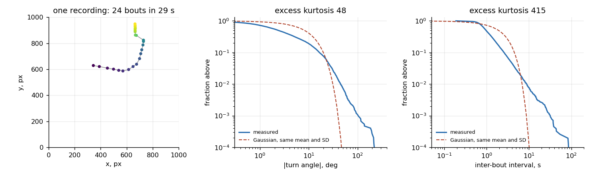
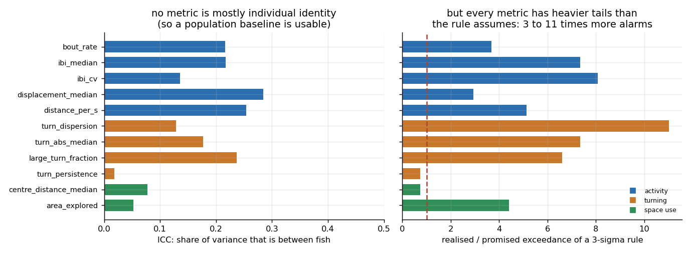
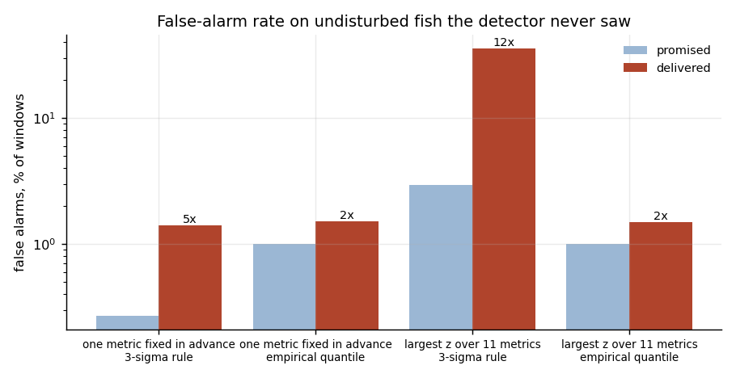
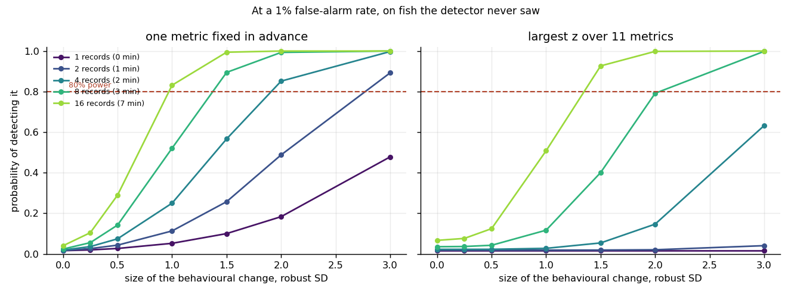
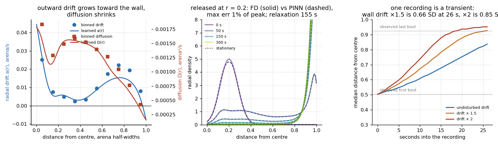

> **Scope, stated first.** The fish in this repository were not stressed. Every
> recording is of undisturbed spontaneous swimming, and that is deliberate.
> What is measured here is the **denominator** — how much an untouched fish
> varies on its own, how often a detector fires when nothing happened, and how
> large a behavioural change has to be before it can be seen at all. Those
> numbers decide whether any later claim about a stressor means anything, and
> they are almost never published.

# What a camera can tell you about a fish, and what it cannot

An aquarium monitored by a camera is an attractive idea. The animals are
continuously visible, tracking is solved, and a behavioural change is supposed
to signal that something has happened to the water, the equipment or the
environment. The literature on it has a ninety-year-old hole in the middle.
The 2018 systematic review of animal-behaviour anomaly reports found that
almost no study defines "abnormal behaviour" quantitatively, and none reports
how often that definition would fire on animals that nothing happened to.

This repository fills that hole for one species, one behaviour and one
detector. It is the part of a monitoring system that has to exist before the
interesting question can be asked.

---

## Where the tank is

Can animals sense an earthquake before it strikes? I am testing it. At the academy in Abu Dhabi there is now a tank running with fish, cameras and field instruments on one clock. This repository builds the foundation for it: a rigorous baseline of normal fish behaviour, so that when the ground moves, the signal stands out.

## What was measured

523 recordings of spontaneous swimming from **39 larval zebrafish**, 16 147
bouts in total, published with the zebrafish hidden-Markov-model tutorial of
J. Fernandez de Cossio Diaz and S. Cocco
([SCocco/ZebrafishHMM](https://github.com/SCocco/ZebrafishHMM)). Each bout
carries its time, position, heading, displacement and turn angle.

Larval zebrafish do not swim continuously. They move in discrete bouts, a
tail beat about once a second. Everything here is therefore defined per bout
rather than per frame, which is what makes recordings of different lengths
comparable.

**504 recordings survive the tracking-quality gate** (at least 8 bouts, at
least 5 s, and every position inside the arena); 19 are rejected. That leaves
6.4 hours of behaviour, a median of 26 s and 21 bouts per recording, and 11
recordings per fish.

Eleven metrics, grouped by what they report:

| group | metrics |
|---|---|
| activity | bout rate, median inter-bout interval, its coefficient of variation, median displacement, distance per second |
| turning | turn-angle dispersion, median absolute turn, fraction of large turns, turn-direction persistence |
| space use | median distance from the arena centre (thigmotaxis), area explored |

---

## What the camera saw

| # | Finding | Evidence |
|---|---------|----------|
| 1 | Behaviour is far heavier-tailed than any threshold rule assumes. Excess kurtosis 48 for turn angle and **415** for the inter-bout interval. | Heavy tails |
| 2 | A three-sigma rule on a single behavioural metric fires 3 to 11 times more often than it promises. On the multivariate scan it is **12 times** more often: 36% of windows instead of 3%. | Heavy tails; A frozen detector |
| 3 | Individual identity is not the problem it is usually assumed to be. No metric has an intraclass correlation above 0.28, so a population baseline is usable and per-animal calibration is not essential. | The animal or the moment |
| 4 | Calibrating the threshold on the data instead of on a Gaussian fixes most of it — 1% promised, 1.5% delivered. The residual 1.5× is the price of meeting a fish the detector has never seen. | A frozen detector |
| 5 | Fixing one metric in advance roughly doubles the power of the same detector: 0.83 against 0.51 for a one-SD change over seven minutes, and at a *lower* delivered false-alarm rate (4.0% against 6.7%), so the comparison is not at equal false alarms and understates the gap. | How long a look |
| 6 | Seven minutes of observation are needed to detect a one-standard-deviation behavioural change with 80% probability. A single 26-second recording detects a **three**-SD change less than half the time. The seven-minute figure is bought at a delivered false-alarm rate of **4%**, not the 1% it was calibrated to: pooling shrinks the noise but not the gap between the calibration fish and new ones. | How long a look; Where the pooled power table gets it wrong |
| 7 | Space use is a drift–diffusion process, and the recordings never reach its steady state. A fish released near the centre needs **155 s** to forget where it started, six times the length of a recording. The "distance from centre" metric in these data measures where the fish was put, not where it lives, and a 50% stronger wall drift is worth only 0.66 SD after 26 s. | Space use as physics |
| 8 | The scan's threshold is a robust z of **12** against 3.15 for the single metric, and two metrics set it: turn dispersion owns 57 % of the scan's alarms, median absolute turn 28 %, and seven of the eleven — the primary among them — never fire. At one recording the scan is *exactly* blind to a 3 SD change in the primary (detection 1.50 %, its false-alarm rate). Dropping the worst metric buys 0.03 of power; calibrating each metric in its own tail needs the 1-in-1100 tail of each, which 300 recordings cannot supply (delivered 3.8 %). | Who sets the scan's threshold |

### Heavy tails

The left panel is one recording: 24 bouts over 29 s, coloured by time. The
other two are the survival curves of the two quantities any monitoring system
computes first, drawn against the Gaussian with the same mean and standard
deviation.

They are not close. Turn angle has an excess kurtosis of 48. The inter-bout
interval — the "is the fish moving normally?" variable — has an excess
kurtosis of **415**. Intervals five and ten times the mean occur at rates a
normal distribution puts at effectively zero.

This matters in practice. A threshold at three standard deviations is chosen
because it corresponds to 0.27% of observations. On these quantities it
corresponds to:

| bout-level quantity | excess kurtosis | 3σ exceedance | times the promise | at 2σ | at 4σ |
|---|---|---|---|---|---|
| turn angle | 47.6 | 1.86% | 7× | 1.1× | **133×** (1 in 119) |
| displacement | 3.8 | 1.24% | 5× | 0.9× | 49× (1 in 323) |
| inter-bout interval | 414.9 | 1.09% | 4× | 0.4× | 102× (1 in 155) |

At one decision per minute, "one false alarm in 370" and "one false alarm in
54" are the difference between four a day and twenty-seven.

The last two columns say where the tail starts. At two sigma all three
quantities are at or below the Gaussian promise (the inter-bout interval at
less than half of it: the bulk is narrower than its standard deviation
suggests, because the standard deviation is itself inflated by the tail).
At four sigma, where a Gaussian rule promises one exceedance in 15 800, the
turn angle delivers one in 119. Raising the threshold from three to four
sigma cuts the *promised* false-alarm rate by 43× and the *delivered* one by
2.2× (1.86% to 0.84%). A stricter Gaussian threshold buys almost nothing on
these data; a calibrated one is the only kind that means what it says.

### The animal or the moment

If a metric differs mainly between individuals, a population threshold spends
its budget telling fish apart rather than detecting events, and every tank
needs its own baseline. The one-way intraclass correlation splits the variance
directly.

| metric | ICC | 3σ exceedance ratio |
|---|---|---|
| displacement median | 0.28 | 2.9× |
| distance per second | 0.25 | 5.1× |
| large-turn fraction | 0.24 | 6.6× |
| bout rate | 0.22 | 3.7× |
| inter-bout interval median | 0.22 | 7.3× |
| turn dispersion | 0.13 | **11.0×** |
| turn persistence | 0.02 | 0.7× |
| centre distance (thigmotaxis) | 0.08 | 0.7× |

The good news is on the left. **No metric exceeds ICC 0.28**, so 72% or more
of the variance in every one of them is within-animal. A baseline built on a
population transfers to a new individual. Per-fish calibration would buy
something, but it is not the difference between working and not working.

The bad news is on the right, and it is uncorrelated with the good news. The
metrics with the least individual structure are among the worst-behaved in the
tail. Turn dispersion has an ICC of 0.13 and fires eleven times more often
than a three-sigma rule promises. Two of the eleven — turn persistence and
distance from the centre — are close to Gaussian and behave themselves. They
are also the two with the lowest ICC. On both counts they are the metrics a
threshold should be built on.

### A frozen detector

The detector is deliberately simple enough to pre-register in a paragraph.
Centre each metric on the median of the training recordings, scale it by the
median absolute deviation, and threshold. Two versions, differing only in how
many places they look:

- **single** — the robust z of one metric fixed in advance (bout rate)
- **scan** — the largest absolute robust z across all eleven

Training and test fish are disjoint in every one of 200 random splits, so
nothing learned about one animal helps on another. All recordings are of
undisturbed fish, so every alarm is a false alarm.

| statistic | threshold rule | promised | delivered | ratio |
|---|---|---|---|---|
| single | 3σ | 0.27% | 1.42% | 5.3× |
| single | empirical 99th percentile | 1.00% | 1.53% | 1.5× |
| scan | 3σ, Bonferroni for 11 metrics | 2.93% | **35.64%** | 12.2× |
| scan | empirical 99th percentile | 1.00% | 1.50% | 1.5× |

Two things follow.

**The Gaussian rule is not conservative. It is optimistic by an order of
magnitude.** The multivariate dashboard is worse than the single metric
because the tails compound. Taking a maximum over eleven heavy-tailed
variables lands in the tail of the worst one. A system built this way spends a
third of its windows in alarm and is switched off in a week.

**Calibrating on the data fixes most of it.** Setting the threshold at the
99th percentile of the training statistic delivers 1.5% instead of the
promised 1%. The residual 50% overshoot is not a mistake. It is the cost of
generalising to a fish the detector has never seen, and it is the number to
budget for. Anyone reporting a calibrated false-alarm rate measured on the
same animals it was fitted to is understating it by that factor.

### How long a look

A known shift is injected into the primary metric of held-out recordings, and
the detection rate is measured at the calibrated 1% false-alarm threshold. The
shift is quoted in robust standard deviations of that metric across
undisturbed recordings. That is the only scale on which "a behavioural change
of this size" is meaningful.

Detection probability, single pre-specified metric:

| observation | 0.5 SD | 1 SD | 1.5 SD | 2 SD | 3 SD |
|---|---|---|---|---|---|
| 1 record (26 s) | 0.02 | 0.05 | 0.09 | 0.17 | 0.47 |
| 4 records (2 min) | 0.07 | 0.25 | 0.57 | 0.85 | 1.00 |
| 8 records (3 min) | 0.14 | 0.52 | 0.89 | 0.99 | 1.00 |
| 16 records (7 min) | 0.29 | **0.83** | 0.99 | 1.00 | 1.00 |

And the same for the scan over all eleven metrics:

| observation | 1 SD | 1.5 SD | 2 SD |
|---|---|---|---|
| 8 records (3 min) | 0.12 | 0.40 | 0.79 |
| 16 records (7 min) | 0.51 | 0.93 | 1.00 |

**A single short recording is nearly blind.** Even a three-standard-deviation
change — a fish behaving unlike 99.7% of undisturbed recordings — is caught
less than half the time in 26 seconds. For the scan it is not "nearly": its
detection rate at one recording is 1.50 % at every shift up to 3 SD, the same
as its false-alarm rate (see "Who sets the scan's threshold").

**Seven minutes buys a one-SD change at 83%.** That is the design number. A
monitoring system that must react to a moderate behavioural change needs
minutes of integration, not seconds. Its alarm latency is set by that, not
by the frame rate.

**Deciding what to look at, in advance, is worth as much as looking twice as
long.** At one SD over seven minutes the pre-specified metric reaches 0.83 and
the scan 0.51. The scan pays for its freedom to find the change anywhere with
a threshold high enough to survive the two heaviest of the eleven tails (turn
dispersion and median absolute turn set it between them; the section after
next has the per-metric table). This is the practical
form of the multiple-comparisons rule. It argues for a single named primary
endpoint fixed before the recording starts.

### Where the pooled power table gets it wrong

The power tables above are read at "the calibrated 1% false-alarm
threshold". That is true of the one-recording row and progressively less
true of the others. The zero-effect column of the same sweep, which the
earlier text did not report, is the false-alarm rate the pooled detector
actually delivers on undisturbed held-out fish:

| pooled recordings | minutes | single: delivered | vs 1% promised | scan: delivered | vs 1% promised |
|---|---|---|---|---|---|
| 1 | 0.4 | 1.58% | 1.6× | 1.50% | 1.5× |
| 2 | 0.9 | 1.63% | 1.6× | 1.85% | 1.8× |
| 4 | 1.7 | 1.91% | 1.9× | 2.24% | 2.2× |
| 8 | 3.5 | 2.38% | 2.4× | 3.54% | 3.5× |
| 16 | 7.0 | **4.02%** | 4.0× | **6.66%** | 6.7× |

So the design number, "seven minutes buys a one-SD change at 83%", was
bought at a delivered false-alarm rate of 4%, not 1%; the scan's 0.51 at
the same point came with 6.7%. Net of false alarms the seven-minute figures
are 0.79 (single) and 0.44 (scan), and the pre-specified metric's advantage
over the scan is slightly larger than stated, not smaller.

The mechanism is the one from "The animal or the moment", turned around.
Averaging k recordings shrinks the record-to-record spread by √k. It does
not shrink the offset between the 23 fish the threshold was calibrated on
and the 16 it is tested on, which is a between-fish quantity and is fixed
for the split. The size of the effect is set by the ICC. For a mean of k
records with ICC 0.22 (bout rate), the between-fish share of the variance
is k·ICC / (1 + (k−1)·ICC): 0.22 at one record, 0.53 at four, **0.82 at
sixteen**. Identity is "not the problem" for a single recording because it
is a fifth of the variance there. Pool sixteen and it is four fifths, and
the calibration gap that cost 1.5× at one record costs 4× at sixteen. The
two findings are the same fact seen from either end. (The pooled records
here are drawn from all 16 held-out fish, so the sweep is if anything
kinder than a real tank, where the k records come from the same few
animals.) The practical consequence is that a monitoring system
integrating over minutes needs its threshold calibrated on pooled records
from *other* animals, at the same k, and should budget for a
generalisation overshoot that grows with the integration time rather than
the fixed 1.5× quoted above.

These numbers come from `src/pooling_check.py`, which reads the two results
files and writes `results/pooling_check.json`; `tests/test_readme_numbers.py`
pins the tables on this page to those files.

### Who sets the scan's threshold

The scan is the maximum of eleven absolute robust z-scores, and its
calibrated threshold is a robust z of **11.97** (median over the 200 splits)
against **3.15** for the single metric — 3.8 times higher. The same 200
splits re-run with the per-metric picture kept (`src/scan_threshold_check.py`;
the exp2 pooled sweep reproduces exactly on the way) say where that number
comes from:

| metric | 99th percentile of \|z\| in training | 99.9th | share of the scan's held-out alarms |
|---|---|---|---|
| turn dispersion | 10.17 | 14.55 | 57 % |
| median absolute turn | 8.01 | 11.70 | 28 % |
| inter-bout interval median | 6.58 | 9.56 | 6 % |
| inter-bout interval CV | 6.36 | 10.73 | 9 % |
| distance per second | 4.52 | 5.73 | 0 % |
| area explored | 4.16 | 5.82 | 0 % |
| large-turn fraction | 3.64 | 4.29 | 0 % |
| displacement median | 3.23 | 3.66 | 0 % |
| bout rate | 3.15 | 3.90 | 0 % |
| turn persistence | 2.89 | 3.58 | 0 % |
| centre distance (thigmotaxis) | 2.41 | 2.88 | 0 % |

Two metrics set the threshold. Turn dispersion is the arg-max in **57 %** of
the scan's held-out alarms and median absolute turn in 28 %; the two
inter-bout-interval metrics take the remaining 15 %, and **seven of the
eleven metrics — the primary among them — fire in none** (their own 99.9th
percentiles, 2.9–5.8, never reach 12). The scan's threshold sits above the
99.9th percentile of every metric but one. So a 3-robust-SD shift in bout
rate moves a z-score that is being compared with 12: at one recording the
scan's detection rate is **1.50 % at 0, 0.25, 0.5, 1, 1.5, 2 and 3 SD alike**
— its false-alarm rate, to four decimals. "Nearly blind" above is the single
metric; the scan at one recording is exactly blind to anything up to 3 SD in
the primary. At two recordings a 3 SD shift lifts it to 4.1 %; at four, 63 %.

Is it one metric's fault? Each metric left out in turn, on the same splits
and the same pooled draws:

| scan variant | threshold (median z) | delivered false alarms, 1 recording | detects 3 SD in 1 recording | detects 1 SD in 16 recordings |
|---|---|---|---|---|
| all eleven | 11.97 | 1.50 % | 0.015 | 0.508 |
| without turn dispersion | 9.73 | 1.62 % | 0.016 | 0.542 |
| without median absolute turn | 11.20 | 1.32 % | 0.013 | 0.528 |
| without inter-bout interval CV | 11.61 | 1.54 % | 0.015 | 0.549 |
| without any one of the other seven | 11.94–11.97 | 1.43–1.50 % | 0.014–0.015 | 0.510–0.530 |
| each metric in its own tail (q = 0.9998) | 3.97 on bout rate | 3.81 % | 0.230 | 0.687 at 10.9 % |
| single metric, bout rate | 3.15 | 1.53 % | 0.478 | 0.832 |

No. Dropping turn dispersion brings the threshold from 12 to 9.7 — median
absolute turn takes over — and buys 0.03 of power at sixteen recordings; no
single removal buys more than 0.04. The repair a statistician would reach
for, testing each metric in its own tail so that the eleven do not share one
z scale, works and is unaffordable here: the common quantile that puts the
union of the eleven exceedances at 1 % of the training records is
**0.9998**, which with about 300 training recordings is each metric's sample
maximum. It brings the bout-rate threshold down to 3.97, the 3 SD detection
at one recording up to 0.23 and the 1 SD detection at sixteen to 0.69 — and
delivers **3.8 %** false alarms at one recording and 10.9 % at sixteen,
because the maximum of 300 records does not generalise to the next fish. An
eleven-metric scan at 1 % needs each metric's 1-in-1100 tail, which 300
recordings cannot supply; the single metric needs the 1-in-100 tail, which
they can. That, rather than "eleven heavy tails", is the mechanism behind
finding 5: two tails set the threshold, and the sample is too small to
calibrate them separately.

The smallest change worth looking for, read from the stored power tables at
80 % detection (linear interpolation between grid points; "> 3" where a 3 SD
shift does not reach it; at the delivered false-alarm rates of the previous
section, not at 1 %):

| pooled recordings | minutes | single metric, SD | scan, SD |
|---|---|---|---|
| 1 | 0.4 | > 3 | > 3 |
| 2 | 0.9 | 2.77 | > 3 |
| 4 | 1.7 | 1.91 | > 3 |
| 8 | 3.5 | 1.37 | 2.04 |
| 16 | 7.0 | 0.97 | 1.35 |

*What this does not show.* The eleven metrics were fixed before the data
were seen, so "drop turn dispersion" is a post-hoc choice and the row says
only how much it would have mattered. The per-metric calibration uses the
same 60 % of fish as everything else, with no separate calibration set; more
training fish would shrink its 3.8 %, and how fast is not measured. The
shift is injected into one metric; a stressor that moved several metrics at
once is a different question, and the scan would meet it on better terms.

These numbers come from `src/scan_threshold_check.py`, which needs the
recordings, and are pinned by `tests/test_scan_threshold.py`, which does not.

---

## Space use as physics

Thigmotaxis — staying near the wall — is the standard anxiety-like readout
in fish, reported as one number, the median distance from the centre. That
number is the steady state of a physical process. Bout to bout, the radial
position is a random walk with a position-dependent drift a(r) toward the
wall and a position-dependent diffusion D(r). Both can be measured from the
15 450 transitions in the data by the Gaussian transition likelihood. Two
small networks do it, one for each; the binned conditional moments are
plotted over them as the check. The drift is outward everywhere, rising
from 0.003 to 0.015 arena half-widths per second between the middle and the
wall. The diffusion falls by a factor of four over the same range.

With a(r) and D(r) in hand the Fokker–Planck equation

∂p/∂t = -∂/∂r [a(r) p] + ∂²/∂r² [D(r) p],  reflecting walls,

has a stationary solution in closed form and a time-dependent one that a
physics-informed network solves. The finite-difference solution is the
check. The network agrees with it to **1.4% of the peak** and returns the
same relaxation time. Two things come out of the dynamics, and neither was
visible from the metric alone.

**The recordings are transients.** The stationary solution puts 90% of the
density within 10% of the wall and has median radius 0.96. The observed
median is 0.55 (KL divergence 4.4). Those are not the same distribution,
and the reason is in the recordings themselves. They start with the fish
near the centre (median first-bout radius 0.50, 1% at the wall) and **89%
of them end at the wall** (median last-bout radius 0.93). A fish released at
r = 0.2 needs **155 s** for its radial distribution to come within 10% of
the steady state; a recording is 26 s. The distance-from-centre metric used
in the detector sections is therefore a measurement of the release point and
the elapsed time, not of a stable preference. That is also why it has one of
the lowest between-fish ICCs (0.08): there is no individual there to measure
yet.

**A stressor that changes the drift is small in one recording.** Starting
from the observed first-bout distribution and integrating for 26 s, a 50%
stronger wall drift moves the median radius from 0.84 to 0.93 — **0.66
robust SD** of the metric's between-recording spread. A doubled drift gives
0.85 SD. Read against the power table above, that is a change a single
recording catches about one time in twenty, and sixteen pooled recordings
catch four times in five. The physics puts the size of a plausible stress
effect on the same scale as the detector's power. That is the number a
pre-registered protocol needs, and the empirical power sweep could not supply
it on its own.

*On the network.* A network for p(r, t) itself failed twice, and the failures
are kept in the source. With a soft initial condition it found the trivial
solution p = 0 for t > 0. With a hard initial condition and a mass
constraint it could not build the boundary layer at the wall, where the
stationary density peaks at 14. The version that works solves for
u = ln(p / p_stationary), for which the equation becomes
u_t = D u_rr + a u_r + D u_r². No boundary layer, no trivial solution,
reflecting walls as u_r = 0. The change of variable, not the network, is
the method.

---

## Open questions

- **No stressor.** Nothing was done to these fish. The power curves say what
  size of change is detectable. They do not say that any particular stressor
  produces a change of that size. Pairing the two is the next experiment, and
  it needs a treatment group.
- **Larval zebrafish in a small arena**, filmed in short recordings. Bout
  structure, arena size and recording length all enter the numbers. An adult
  fish in a large tank will have different constants. The shape of the
  argument — heavy tails, a calibration gap across individuals, minutes of
  integration — is not species-specific.
- **26-second recordings are not continuous monitoring.** Circadian structure,
  feeding, maintenance and seasonal drift are all absent here, and all of them
  widen the baseline further. These false-alarm rates are therefore a *lower*
  bound on what a 24-hour system would see.
- **Injected shifts are stationary and affect one metric.** A real stressor
  moves several metrics at once and usually transiently. That cuts both ways:
  more channels to detect it in, less time in each.
- **Eleven metrics is a choice.** Adding more raises the scan threshold
  further. The single-endpoint result is the argument for not doing that.
- **The drift–diffusion model is one-dimensional and Markov in the
  radius.** Heading persistence, and the possibility that recordings were
  stopped when the fish reached the wall (89% end there), both bias the
  near-wall drift estimate. The transient conclusion does not depend on
  them; the 155 s does.

---

## Field notes

I published the first version of this on 9 September 2026 under a different
name, renamed it the next day, and opened the code with the space-use section
on 12 September. Several things had to be corrected on the way. An early
version compared the maximum over eleven metrics against a plain three-sigma
rule, which is not a fair comparison. The power curves came out flat once
because thresholds were pooled across splits, and the loader took 25 s until
it was fixed. The large-turn threshold of 30° was also revisited.

The Fokker–Planck network was the part that failed most. Fitting p directly
collapsed to the trivial solution, and the hard-constrained version could not
form the wall boundary layer. Only the log-ratio formulation held. The drift
test also had to change from a rank correlation to Pearson, because the
learned drift is not monotonic in r and Spearman was penalising it for that.

Getting data was its own problem. Dryad sat behind an anti-bot layer, Zenodo
timed out, and a 107 MB set of group trajectories never finished downloading.
The ZebrafishHMM tutorial data came from GitHub without trouble.

---

## Running it

The analysis code is public, in `src/`:

| file | what it is |
|---|---|
| `behaviour.py` | bout-level loader, tracking-quality gate, the eleven metrics |
| `exp1_variability.py` | ICC(1) variance decomposition and the tail characterisation |
| `exp2_detector.py` | the frozen detector, its two threshold rules, false alarms and power |
| `exp3_fp_pinn.py` | neural Kramers–Moyal drift/diffusion, stationary and finite-difference Fokker–Planck, the log-ratio PINN (PyTorch) |
| `pooling_check.py` | false-alarm rate of the pooled detector vs k, the √k / ICC arithmetic, 2σ/3σ/4σ tails — from the results files alone, no recordings needed |
| `scan_threshold_check.py` | who sets the scan's threshold: per-metric tails, arg-max of each alarm, leave-one-metric-out and per-metric-calibrated scans on exp2's splits, minimum detectable effect at 80 % (needs the recordings) |
| `tests/test_all.py` | the ten checks below |
| `tests/test_readme_numbers.py` | pins the tables on this page to `results/*.json` (runs without the recordings) |
| `tests/test_scan_threshold.py` | pins the "Who sets the scan's threshold" section to `results/scan_threshold_check.json` (runs without the recordings) |

The recordings are not redistributed; `data/SOURCE.md` says where they come
from and gives the three-line conversion from the authors' `.mat` file.
With the file in `data/`, `python3 tests/test_all.py` runs in about a
minute and `exp3_fp_pinn.py` in ten. The figure scripts are held privately
(the pooled-power sweep is in `exp2_detector.py`; an earlier version of this
sentence said otherwise).

Ten checks, all passing (two need PyTorch and are skipped without it):

- the loader returns strictly increasing bout times and the quality gate
  rejects a track placed outside the arena
- circular dispersion is 0 for identical angles and about 1 for uniform ones
- bout rate, turn persistence and large-turn fraction stay inside their
  physical ranges on all 504 recordings
- **the ICC estimator recovers a known between-group share** (0.2 and 0.6) from
  synthetic data to within 0.1
- **the tail estimator is calibrated**. On 400 000 genuinely Gaussian samples
  the 3σ exceedance ratio comes back at 1.08, so a ratio of 11 on real data is
  a property of the fish and not of the estimator
- the heavy tails are pinned as a test, so a refactor cannot quietly lose them
- the single-metric statistic never exceeds the scan statistic, by construction
- **the learned drift and diffusion reproduce the binned conditional
  moments** (correlation > 0.85 across bins) and the stationary density
  integrates to one
- **the log-ratio PINN matches the finite-difference solution** of the
  Fokker–Planck equation to 5% of the peak at every saved time

---

## Data and licence

Documentation and figures: CC BY 4.0. The recordings belong to their authors
and are distributed with the ZebrafishHMM tutorial of J. Fernandez de Cossio
Diaz and S. Cocco; cite them, not this page.
